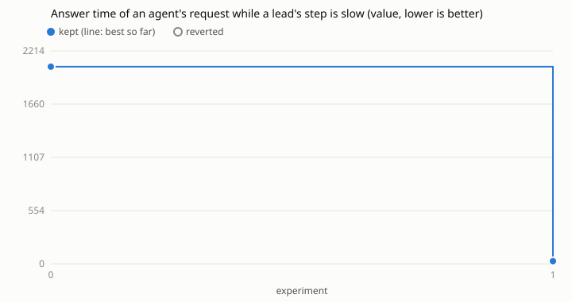

# Loop 4: how long an agent's request waits for its answer from the daemon

Run on 2026-10-30 against ihsan-sa/hive main at 28f4a16a, by the agent of task
261030-220838-a8ce2a55b6 (issue #16) following `../../program.md`. Sent to
hive as ihsan-sa/hive#2229 (see `landed.json` once merged).

- **The complaint:** `hive agent status` took ~12 s under load. In this
  sandbox it took 4.7 s with 0.02 s of client CPU, then 0.09 s a minute later,
  with spikes of 0.8-1.6 s. So the time is spent waiting, not working.
- **Where it waits:** `hive agent <op>` writes a request into the run's
  outbox, and the run's own *step* drains it. The request watcher
  (`Runs.WatchRequests`, 50 ms poll) only woke the tick. A tick runs the
  core and then the modules' tick, synchronously. A non-lead's step waits for
  every lead's step, up to 5 s. The daemon's journal logged "a lead's step is
  still going after 5s" 27 times in the 3 hours before this run. A slow lead or
  a long module tick therefore held every agent's answer, however cheap the op.
- **Metric:** `TestAnswerProbe` (`answer_probe_test.go`, committed in hive's
  `internal/core`, skipped unless `HIVE_ANSWER_PROBE=1`). It drives `Runs`
  the way `app.loop` does: a tick every second and 20 ms after a request is
  seen, each followed by a 300 ms module tick. One lead always has a 2 s op in
  its outbox. A worker sends 12 `ping`s at seeded random gaps, and the probe
  times each from the rename into the outbox to the answer's file appearing
  (1 ms polls). The metric is the median in ms (`metric.sh`). It is
  sleep-driven, so the machine's load barely moves it: baseline 1952-2062.
- **Editable:** `internal/core/runs.go`, `internal/core/ops.go`.
- **Cap:** 10 experiments, 1 used (below for why).

| n | idea | median ms | max ms | kept |
|---|------|----------:|-------:|------|
| 0 | baseline | 2050 | 2653 | |
| 1 | the watcher answers a run's waiting requests itself, claiming the run like a step (`busy`), instead of only waking the tick | 28 | 52 | yes |

**-98.6%.** The fix (`kept/`) adds `Runs.answer`: for each live run with a
`.json` request in its outbox, the watcher starts a goroutine. That goroutine
claims the run the way `stepAsync` does, drains the outbox with `Ops.Drain`
if the run is still Running, Idle or Quiet, and releases the claim. A run that
a step holds is left to that step, so no outbox is ever drained twice at once.
The watcher still wakes the tick for a fresh request, so an idle run with
something pending launches as before. `go test -short` of internal/core,
internal/app and internal/agentcli passed, `-race` on the probe and the
request tests was clean, and `TestTheWatcherAnswersWithoutATick` covers both
the answer and the claim.

## What's left

- The 28 ms left is the watcher's 50 ms poll (≈25 ms on average). A shorter
  poll or inotify would cut it, but at the user's end the client's own back-off
  in `agentcli.call` (looks at 0, 10, 30, 70, 150 ms) sets the floor near
  70-90 ms. A ~20 ms gain isn't worth more `ReadDir` calls on every live run,
  so the loop stopped at 1 experiment.
- An op that is slow itself (a lead's `spawn` or `install`) still holds that
  run's later requests, by design: one drain per run at a time.
- `status` builds its answer by listing every task once per project
  (`projects.Module.Status` → `work.List`, which copies each task). That is
  CPU, not waiting, and was not the cause of the seconds. Profile it next if
  the answer itself turns slow.

## Evidence

Commands, from this repo's root with ihsan-sa/hive cloned at `/hive/home/ar-api/target`
and the probe committed there first (`8d62d049c`, the baseline commit):

    python3 loop.py -c runs/hive-answer/config.json baseline
    python3 loop.py -c runs/hive-answer/config.json try --idea "..."
    python3 loop.py -c runs/hive-answer/config.json plot

`results.tsv` has every try, with max, p90 and min in `extra`. `patches/001.patch`
is the try's diff, and `kept/` has the commit sent to hive (the try plus its
regression test and the probe).
