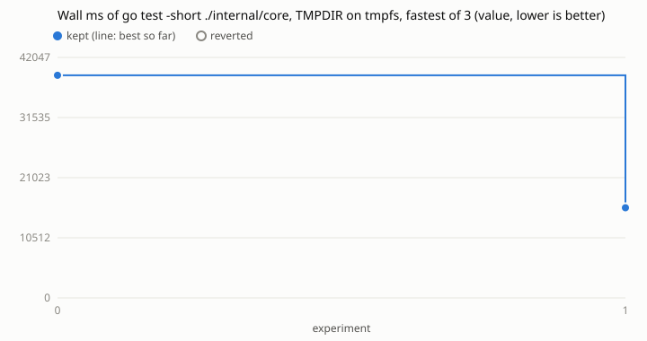

# Loop 5: wall ms of `go test -short ./internal/core` in ihsan-sa/hive

Run on 2026-10-30 against ihsan-sa/hive main at 28f4a16a, by the agent of task
261030-220843-a82ab2b382 (issue #19, "make the Hive faster on `go test -short
./...` wall and CPU time"), following `../../program.md`. Sent to hive as
ihsan-sa/hive#2237 together with loop 4 (`../hive-kb`).

## Picking the target

- **Survey** (`survey.tsv`, from `go test -short -count=1 -p 4 -exec timeit.sh ./...`
  with a warm build cache): the test binaries used ~52 CPU s in all (improve 14.2,
  work 13.4, core 9.4, gocache 6.9; the rest under 3), and the whole `go test` 97 CPU s,
  so ~45 s went to building and linking. The four core failures in it are this
  sandbox's: a TMPDIR under the hive home is remapped in the nested check sandbox
  (they pass with TMPDIR under /tmp).
- **Wall:** `go test ./...` runs packages side by side, so the suite's wall time is
  roughly its slowest package. On GitHub's runner (ci run 41139068725) that is
  core at 51 s, then kb 37, improve 22, work 20. In this Hive's own last 60 checks
  of hive the medians are work 434 s, core 182, improve 170.
- **Wall that isn't work:** core spent 24 s of its time in two tests at under 1 CPU s
  (`TestGitClearsStaleLock` 12.8 s, `TestGitTimeoutLeavesNoLock` 11.1 s): timers.

## Metric

`proc_io.py --field wall_ms` on the package's `-test.short` binary, with TMPDIR on
tmpfs (`/dev/shm`), fastest of 3 (`../../metrics/min_of.py`). Plain wall time didn't
work here; the logs keep each attempt:

- `logs/baseline-single-run.tsv`: TMPDIR on disk, one run: noise 36%.
- `logs/disk-tmpdir-fastest-of-3.tsv`: on disk, fastest of 3: noise 19%, margin 56%.
  The same change as try 1 below made +51.7% there, reverted as under the margin
  (`logs/disk-tmpdir-patches/001.patch`).
- `logs/tmpfs-single-run.tsv`: tmpfs, one run, while the machine hit load 85
  (CPU pressure 77%): 42-152 s.
- `results.tsv`: tmpfs, fastest of 3: noise 4%, margin 12%.

Core writes ~1 GB to TMPDIR per run (`write_bytes` in the logs), so tmpfs also
keeps each measurement off the wearing SSD. Cap: 10 experiments; 1 used.

| n | idea | wall s | vs best | kept |
|---|------|------:|--------:|------|
| 0 | baseline | 38.9 | | |
| 1 | `TestGitClearsStaleLock`'s fresh lock waits 1 ms per retry, not core's 1+3+8 s; `TestGitTimeoutLeavesNoLock`'s editor sends `sleep 30` to /dev/null, so the cut-off call returns when git ends instead of after the 10 s `WaitDelay` on pipes the orphaned sleep held | 15.8 | -59.5% | yes |

After try 1 no core test takes over 2.5 s on tmpfs; what's left is spread over
hundreds of tests.

`TestGitTimeoutLeavesNoLock` passes with SIGKILL as the cancel signal both before
and after the change (checked by editing `git.go` for one run), so it never pinned
the SIGTERM it describes. The change leaves that as it was; it's said in the PR.

## What it found beyond core: TMPDIR on disk is most of the suite's wall here

With TMPDIR on tmpfs, packages that are slow in this Hive's checks are quick:

| package | wall, TMPDIR on disk (this machine) | wall, TMPDIR on tmpfs | CPU s |
|---|---:|---:|---:|
| internal/mod/work | 164 s (a check's median: 434 s) | 20.0 s | 14.1 |
| internal/mod/improve | 619 s (a disk-busy window) | 21.5 s | 14.0 |
| cmd/hive | 18.6 s | 0.56 s | 0.8 |
| internal/app | 23.5 s | 4.0 s | 0.5 |
| internal/mod/release | 29.2 s | 6.1 s | 2.6 |

The same test swings from 1 s to 9.5 s between runs on under 0.5 CPU s: the waits
are this machine's IO stalls (IO pressure 30-75% all day), not the tests. A Hive
check puts TMPDIR on disk on purpose (`checkTmp` in internal/core/disk.go, from
97c76ae4: checks mustn't starve the person's session of memory), so this loop didn't
change it. A check whose TMPDIR were a size-capped tmpfs would probably run
`go test -short ./...` several times faster on this machine and spare the SSD.
That's a design call for the hive project.

## Evidence

From this repo's root, with ihsan-sa/hive cloned at `/hive/home/ar4/target`:

    python3 loop.py -c runs/hive-core/config.json baseline
    python3 loop.py -c runs/hive-core/config.json try --idea "..."
    python3 loop.py -c runs/hive-core/config.json plot
