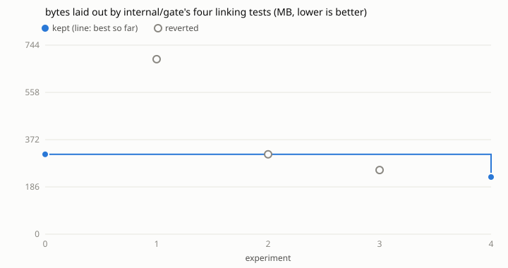

# Loop 2: bytes laid out by `internal/gate`'s tests in ihsan-sa/hive

Run on 2026-10-30 on iiks2 against ihsan-sa/hive main at c1e4e212, by the
agent of task 261030-030242-259f211d98, with the same `../../loop.py` and
`../../program.md` as loop 1 (`../hive-work/`). Nothing in the loop was
rebuilt. What was new: a target chosen by measuring, and a second metric
script (`metrics/laid_out.py`), because this package's bytes have a
different shape from loop 1's.

## Choosing the package

`survey.sh` built every package's test binary and ran it once
(`-test.short -test.count=1`) under `metrics/proc_io.py`. Results are in
`survey.tsv`. Top write_bytes:

| package | write_bytes |
|---|---:|
| internal/gate | 652.9 MB |
| internal/mod/work | ~375 MB (loop 1's baseline; 199 MB after it) |
| internal/gocache | 131.6 MB |
| internal/core | 92.3 MB (didn't finish: timed out at load ~340) |
| internal/mod/improve | 44.2 MB (didn't finish: timed out) |
| internal/mod/kb | 11.1 MB |

Everything else is under 9 MB. So `internal/gate` was the next target.
Measuring it one test at a time (`logs/per-test-write_bytes.tsv`), four
tests write almost all of it: `TestUnitStepIsJudgedByTest` 171 MB,
`TestFindFixes` 94 MB, `TestKilledGateLeavesNoDaemon` 57 MB and
`TestCandidateIsMergedWithBase` 53 MB. Each one builds small Go modules
on two "sides" and links their test binaries. Under strace the bytes turn
out to be linker output: each `p.test` / `e2e.test` is about 3.1 MB, and
it's linked again for every side, scenario and rerun.

## The metric, and why it isn't write_bytes

write_bytes from `/proc/self/io`, which worked in loop 1, didn't hold
still here. Three baseline runs gave 571 / 651 / 614 MB, a 13% spread
(`logs/write_bytes-baseline.tsv`). Clearing the test cache first gave
683 / 576 / 589 MB, 18% (`logs/write_bytes-clean-testcache-baseline.tsv`).
The loop's margin would have been 39-55%. The linker writes its output
through mmap, and write_bytes counts a page again whenever writeback
catches it mid-link. How often that happens depends on the machine's load
(80-340 on 20 cores during this run). Loop 1's bytes were plain `write()`
calls from git, which is why its noise stayed under 0.06%.

`metrics/laid_out.py` runs the command under strace and counts what was
asked of the filesystem instead. That's each regular file's largest
ftruncate/fallocate size (its final size, for a linked binary), else the
bytes `write`/`pwrite`/`writev` put in it. Pipes, sockets and /dev are left
out. It prints `io_write_bytes` (the kernel's figure) next to it.

Even so, the whole package still varied 17% (368-439 MB,
`logs/laid_out-whole-package-baseline.tsv`). Each heavy test alone repeats
almost exactly (`logs/per-test-laid_out-twice.txt`: 45,827,662 vs
45,826,697 bytes). The extra work comes from the gate's own deadlines and
reruns under load. So the metric is scoped to the four linking tests:

    go clean -testcache && laid_out.py ... gate.test -test.short -test.count=1 \
      -test.run '^(TestUnitStepIsJudgedByTest|TestFindFixes|TestCandidateIsMergedWithBase|TestKilledGateLeavesNoDaemon)$'

Its baseline is 314.3 MB, and three runs spread 0.03%. `go clean -testcache`
comes first so that no run reuses an earlier run's cached test results.

- **Editable:** `internal/gate/*_test.go`, plus `internal/gate/child.go`
  from try 4 on (see below).
- **Cap:** 12 experiments. 4 used.

| n | idea | laid out | vs best | kept |
|---|------|------------:|--------:|------|
| 0 | baseline (four linking tests) | 314.3 MB | | |
| 1 | `TestMain`: `GOFLAGS=-trimpath` | 688.8 MB | +119% | no: compiled the standard library with -trimpath into the build cache once (394 MB of plain writes) |
| 2 | the same, with that cache now warm | 314.3 MB | 0.0% | no |
| 3 | `testGoFlags=-trimpath` through `Child.Env` | 252.3 MB | -20% | crash: changes `go vet`'s file names, so `new-package` lost its `r (vet)` |
| 4 | `testTrimpath`: `-trimpath` on the sides' `go test` only | 224.9 MB | **-28.4%** | yes |

Before try 1, an unrecorded try with `TestMain` setting `GOFLAGS=-ldflags=-s`
measured 624 vs 614 MB of write_bytes. It's in
`logs/write_bytes-baseline.tsv`, from before the metric changed. That try
and tries 1-2 did nothing for the same reason: the gate sets each side's
`GOFLAGS=-mod=readonly` itself (`offline` in gate.go), which overrides
anything the tests put in the environment. No test file can reach the
sides' go commands, so try 4 adds a test hook beside the existing
`testGoCache`, in `child.go`. `testTrimpath` is a package variable that
only this package's `TestMain` sets. When it's set, `ExecIn` adds
`-trimpath` to an unsandboxed side's `go test`. A gate never sets it, and a
bubblewrap side is left alone.

Why it helps: without `-trimpath`, each side's checkout path is compiled
into its test binaries. So two sides with the same package never share a
test binary, and `go test` can't reuse a passed result. With it, a control
side at the same base as an earlier one gets `(cached)` and links nothing.

Total for the four tests: **314.3 → 224.9 MB (-28.4%)**. The kernel's
io_write_bytes for the same runs: 376 → 270 MB. The kept run's two
measurements (235.9 and 213.9 MB) differ by 10%. The first one also put
the new `-trimpath` fixture builds in the build cache, so the loop's
margin for a next try is now 29%.

## What's left

All the bytes left are links that can't be skipped: test binaries of
packages that really differ per side or fail (failures aren't cached), the
evaluator's `go test -c ./internal/e2e/`, the `go build` of each side's
`cmd/hive`, and `builtHive`'s full hive binary (28 MB) in
`TestKilledGateLeavesNoDaemon`. Going further means fewer scenarios per
`Run`, or building the fixture's shared binaries once per process.

## Evidence

`results.tsv` has every try, with each run's value in `runs` and the
metric's key=value output (laid_out_bytes, write_bytes, sized_bytes, files,
io_write_bytes, wall_s) in `extra`. `patches/NNN.patch` is every try's
diff. `kept/` is the kept commit as a patch for ihsan-sa/hive c1e4e212
(`git am`). `logs/` holds the earlier baselines and the per-test
measurements. Commands, from this repo's root, with ihsan-sa/hive cloned
at `/hive/home/ar/target`:

    sh runs/hive-gate/survey.sh                      # once: the survey
    python3 loop.py -c runs/hive-gate/config.json baseline
    python3 loop.py -c runs/hive-gate/config.json try --idea "..."
    python3 loop.py -c runs/hive-gate/config.json plot
