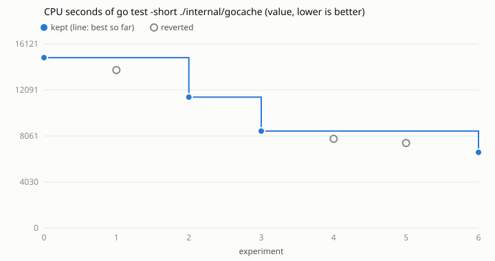

# Loop 3: CPU seconds of `go test -short ./internal/gocache` in ihsan-sa/hive

Run on 2026-10-30 against ihsan-sa/hive main at de0d3b6f, by the agent of task
261030-162335-e9c7d8a2a0 (issue #12) following `../../program.md`. Landed on
hive main as ihsan-sa/hive#2223 (see `landed.json`).

- **Why CPU:** the person asked for speed. Loops 1-2 cut bytes written, because
  wall time swings with load. CPU time holds steadier, and on this machine (load
  30-270 on 20 cores) CPU is what every check waits on.
- **Target:** `survey.tsv` (from `survey.sh`) measured the packages that used
  the most CPU in loop 2's survey, on current main. `internal/gocache` was the
  heaviest at 15.4 CPU s; `mod/modules` was next at 5.0 (`core` was 10.5 in
  the older survey). The survey of all 45 packages was cut short: under load
  each test binary took minutes to link, and two machine restarts killed it.
- **Metric:** `cpu_ms` (user+sys of the test binary and every child it
  reaped, from `getrusage`) via `metrics/proc_io.py`, which now prints
  `cpu_ms`. The first baseline used `cpu_s`, and loop.py rounds that to whole
  seconds, so it was redone in ms (`logs/baseline-rounded-to-seconds.*`).
- **Noise:** 6.7% across the baseline runs, so the margin to beat was 20-21%.
- **Cap:** 20 experiments; 6 used. What's left is the test's own work (below).
- **Editable:** `internal/gocache/*_test.go` only.

| n | idea | CPU s | vs best | kept |
|---|------|------:|--------:|------|
| 0 | baseline | 14.93 | | |
| 1 | inner `go test -vet=off` (a cold cache vets every stdlib dep for facts) | 13.84 | -7.3% | no (under margin) |
| 2 | cheapest inner build: `-vet=off`, `-gcflags=all=-N -l`, `-ldflags=-s -w`, `CGO_ENABLED=0` | 11.46 | -23.2% | yes |
| 3 | `-gcflags` adds `-dwarf=false`; `GOGC=400` in the tools | 8.50 | -25.9% | yes |
| 4 | `-c=1` (one-thread compiler backend) | 7.82 | -8.0% | no (under margin) |
| 5 | `-c=1` with `GOGC=1000` | 7.45 | -12.3% | no (under margin) |
| 6 | `-c=1`, `GOGC=off`, `GOMAXPROCS=4` | 6.63 | -22.0% | yes |

**Interleaved check** (`abab.sh` → `logs/abab.tsv`): the baseline and final
commits, alternating, 3 rounds each on the same machine state: 14.1-14.6 s
before, 6.7-6.8 s after, so **-53%**, every run green. Wall time is listed
there too but swung 4-154 s with load.

In a direct A/B, `GOMAXPROCS=4` vs 20 made no CPU difference (5.10 vs 5.11 s
user). It stays because it caps the inner build at 4 compiles at once, which
bounds memory with GC off. Wall time on the idle-ish machine swung 2.6-17 s
between identical builds, with no consistent cost from `-c=1` or `GOGC=off`.

## What's left

After try 6 the package spends nearly all its CPU on one thing: the test's
first `go test` compiles testing's 131 standard-library packages into an empty
`GOCACHE`. That cold fill is what the test checks, so it can't be cached away
from inside the test. The next loop should take the next package by CPU (or
CPU per check in the Hive's own check logs: mod/work, mod/improve, core,
mod/release).

## Evidence

Commands, from this repo's root with ihsan-sa/hive cloned at `/hive/home/ar3/target`:

    python3 loop.py -c runs/hive-gocache/config.json baseline
    python3 loop.py -c runs/hive-gocache/config.json try --idea "..."   # once per row
    python3 loop.py -c runs/hive-gocache/config.json plot
    sh runs/hive-gocache/abab.sh

`results.tsv` has every try (`extra` holds every metric field), `patches/` has
each try's diff, and `kept/` has the commit that landed on hive main (its comment
reflowed; code identical to try 6).
