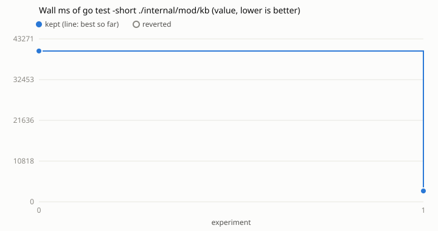

# Loop 4: wall ms of `go test -short ./internal/mod/kb` in ihsan-sa/hive

Run on 2026-10-30 against ihsan-sa/hive main at 28f4a16a, by the agent of task
261030-220843-a82ab2b382 (issue #19), following `../../program.md`. Landed on hive main
as ihsan-sa/hive#2237 (59774c55, `landed.json`) together with loop 5 (`../hive-core`, which has the survey
behind both).

- **Why kb:** on GitHub's runner kb is the second-slowest package of
  `go test -short ./...` (37 s, after core's 51), and here it took 43.6 s on 1.0 CPU s.
  One test was 36.5 s of it: `TestSeedingReportsAFailedCommit`.
- **Metric:** `proc_io.py --field wall_ms` on the package's `-test.short` binary.
  Noise 7.6% across the baseline runs, margin 22.9%. Cap: 10 experiments; 1 used.

| n | idea | wall s | vs best | kept |
|---|------|------:|--------:|------|
| 0 | baseline | 40.1 | | |
| 1 | the test fails `git add` with a directory where `.git/index` belongs, not a held `index.lock`: a lock makes core.Git wait 1+3+8 s for its holder on each of 3 calls | 2.9 | -92.8% | yes |

The test still guards what it did: with kb.go's "practice docs not committed"
journal line removed, it fails.

## Evidence

    python3 loop.py -c runs/hive-kb/config.json baseline
    python3 loop.py -c runs/hive-kb/config.json try --idea "..."
    python3 loop.py -c runs/hive-kb/config.json plot
