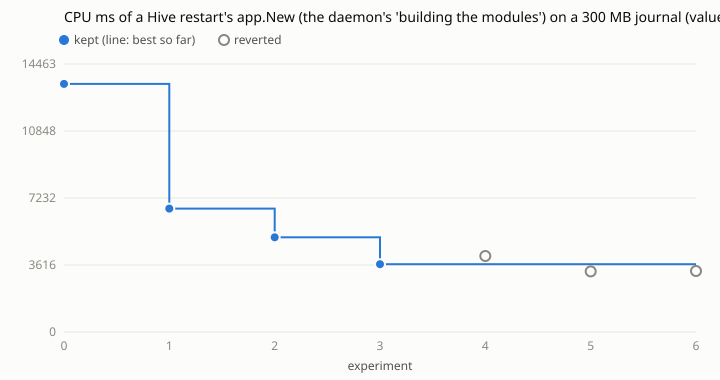

# Loop 4: CPU of a Hive restart's `app.New` in ihsan-sa/hive

Run on 2026-10-30 against ihsan-sa/hive main at 28f4a16a, by the agent of task
261030-220840-3a64290f49 (issue #17, "the Hive's start time") following
`../../program.md`.

- **Why this:** the daemon logs where its start goes. On this machine it said
  `took 1m48.761s to start: 449ms before building the modules, 1m23.582s
  building them, 24.73s after` (others: 44 s, 15 s, 11 s). "Building the
  modules" is `app.New`, which builds nothing. It replays the journal
  (`.hive/events.jsonl`, 1.1 GB and 227k events on 2026-10-30) once per module,
  about 17 times, `json.Unmarshal`ing every line each time. On 300 MB that
  allocated 15 GB and used 13 s of CPU. Modules aren't built at start: a
  module's program is `go run` on the shared GOCACHE when the runner starts
  it.
- **Measure:** `internal/app/startmeasure_test.go`, the first commit on the
  loop's branch. It is skipped unless `HIVE_START_JOURNAL` and `HIVE_START_WS`
  are set. It copies a journal into a fresh workspace and opens it once, so the
  kb record is caught up as a running Hive's is. Then it opens it again, as a
  restart does, and prints the CPU (getrusage user+sys) and bytes allocated by
  that second `New`. The journal is the first 300 MB of this Hive's
  (42,092 events). It and the workspace sit on tmpfs (`/dev/shm`), so no
  experiment wrote to the SSD.
- **Metric, normalised for load:** raw CPU of one unchanged binary drifted 15%
  as load went from 40 to 87 (`logs/raw-cpu-results.tsv`, the first attempt,
  with tries that read as regressions only because of load). So `metric.sh`
  runs the candidate and a reference built from the untouched baseline
  alternately, twice each. It reports `12996 x candidate/reference`, where
  12,996 ms is the baseline's CPU at load 40. Even so, the ratio of identical
  binaries spread 6.7-8.7% at load 60-90, so the margin to keep a change was
  20-26%.
- **Cap:** 20 experiments. 6 used here, plus 4 in the raw-CPU attempt.
- **Editable:** `internal/core/*.go`, `internal/mod/*.go`.

| n | idea | metric (ms) | vs best | kept |
|---|------|------:|--------:|------|
| 0 | baseline | 13,392 | | |
| 1 | journal parses the fixed envelope `Append` writes (`{"seq","at","kind","data"}`) itself, leaving data raw for `Decode`. Any other line goes through `json.Unmarshal` (42,092/42,092 lines fast and identical) | 6,662 | -50.3% | yes |
| 2 | journal reads in place (`ReadSlice`, 1 MB buffer) and copies out only an event's data. `ReplayExcept`: the 12 replays that never read `task.saved`/`run.created` (92% of the bytes) pass over them uncopied | 5,110 | -23.3% | yes |
| 3 | kb's recorder keeps a snapshot filed before this start as raw data under its subject (5 top-level fields read with jsontext), decoded only if a later one diffs against it | 3,660 | -28.4% | yes |
| 4 | improve, work and feedback pass over `run.created`; runs passes over `task.saved` | 4,099 | +12.0% | no (1 run, load) |
| 5 | improve decodes a `task.saved` once for its three appliers | 3,270 | -10.7% | no (under margin) |
| 6 | 4 + 5 together | 3,294 | -10.0% | no (under margin) |

**Result:** 13,392 → 3,660 ms of CPU for a restart's `app.New` on 300 MB of
journal (**-73%**). Bytes allocated, which load doesn't move: 15,213 →
3,922 MB (-74%). Mallocs: 17.0 → 4.9 million. The cost is linear in the
journal, so a restart on today's 1.1 GB should go from about 48 s of CPU to
about 13 s.

## What's left

What's left is the modules' own `Decode`s of `task.saved` and `run.created`
(improve, stats, runs, work, feedback: about 2.3 s of the last profile) and
about 17 reads of the file from the page cache (about 0.9 s). Tries 4-6 cut
about 10%, which the load-inflated noise couldn't confirm. They are in
`patches/` to take again on a quieter machine. Past that, the next step is
structural: one pass over the journal at start that hands each event to every
module, or snapshots of module state so a start doesn't replay history at
all.

## Evidence

Commands, from this repo's root with ihsan-sa/hive cloned at `/hive/home/ar4/target`
and the first 300 MB of the journal (cut at a line end) at `/dev/shm/ev.part`:

    python3 loop.py -c runs/hive-start/config.json baseline
    python3 loop.py -c runs/hive-start/config.json try --idea "..."   # once per row
    python3 loop.py -c runs/hive-start/config.json plot

`results.tsv` has every try, with `extra` holding the raw CPU of candidate and
reference, the bytes allocated and the mallocs. `patches/` has each try's diff,
and `kept/` has the commits sent to hive.
