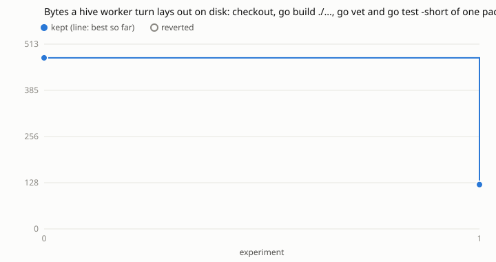

# Loop 4: bytes a hive worker turn lays out on disk (checkout, build, scratch)

Run on 2026-10-30 against ihsan-sa/hive main at 28f4a16a, by the agent of task
261030-220842-683be1dade (issue #18) following `../../program.md`. Landed on hive
main as ihsan-sa/hive#2231 (9a5c972b, CI green: test and sandboxed-e2e; see
`landed.json`).

- **Why a whole turn:** the person asked for faster software, and the SSD is
  wearing (48 TB in 17 days). Loops 1-3 cut single test packages. This one
  takes what every worker turn writes. `/proc/diskstats` showed the disk
  taking ~28 MB/s (2.4 TB/day) from the host. Checks with `disk_wrote`
  recorded on 10-29/30 add up to only ~53 GB, so most of the writes come
  from agents' turns.
- **Where a turn's bytes went:** each run's HOME is its own
  (`.hive/private/runs/<id>/home`), so `~/.cache/go-build`, `~/go/pkg/mod`
  and uv's and pip's caches started **empty on every run**. A worker's
  `go build`/`vet`/`test` of hive rebuilt the standard library and every
  dependency (140 MB of cache, plus the same again in compile scratch and
  19 MB of extracted modules). The checkout itself is small: a fresh
  `git clone --no-local --no-hardlinks` of hive is 6.5 MB of `.git` and
  ~10 MB in all.
- **Metric:** `turn.py`. It asks the target's own code for a worker's env:
  a throwaway `_test.go` calls `Runs.sandboxSpec` for a worker run in home and
  prints `spec.Env`. It then runs the routine under `metrics/laid_out.py`
  (strace, each file's bytes, so writeback timing doesn't move it): NewCheckout's
  clone, `go build ./...`, `go vet ./internal/agentcli`,
  `go test -short ./internal/agentcli`, in a fresh run HOME. The hive user's
  home is `/home/hive`. The checkout goes to one fixed folder, as every
  worker's is `/work`. Go keys a package's build by its folder, so a new
  path each turn would miss every build of the project's own packages (a
  first version did: 181 MB steady instead of 75).
- **Noise:** 0.01% (two cold runs of the untouched target). Margin 5%.
- **Editable:** `internal/core/{runs,home,home_test}.go`.

| n | idea | MB laid out | kept |
|---|------|------:|------|
| 0 | baseline (per-run HOME, empty caches) | 474.9 | |
| 1 | a worker in home gets `XDG_CACHE_HOME` and `GOMODCACHE` in the hive user's home | 123.0 (median of 171.2, 74.7) | yes |

Try 1's first run (171 MB) is the first turn after the change to core: it
fills the shared cache with core and what depends on it. Every turn after
that writes **74.7 MB (-84%)**: 10 MB clone and 63 MB of link outputs (the
test binary and vet). The loop counts the median, -74%.

## What's left, for the next loop

- **Link outputs (63 MB a turn).** Checks already link with `-ldflags=-w`
  (`leanLink`, internal/core/disk.go), a quarter less per link. Workers
  don't. It wasn't tried here: try 1's two runs (fill, then steady) set
  the loop's noise to 78%, so no further try could clear the margin. Giving
  workers `GOFLAGS=-ldflags=-w` also changes what agents' own binaries carry.
  A next loop should take it with a fresh baseline on the shared caches.
- **The real home crosses with dispatch.** dispatch's `planFor` sends an
  RW mount whole, and a run in home mounts `/home/hive` RW (8.6 GB of
  go-build, 62 GB of hive-eval cache). That predates this change. If dispatch
  is live, it's worth a look.
- **Other projects:** the checkout for hifi-receiver-2 is ~270 MB (203 MB of
  `.git`), and pll and hwde are ~150 MB each, per run. `--reference` to the
  host clone (alternates, read-only in the sandbox) would write almost none
  of it.

## Evidence

Commands, from this repo's root, with ihsan-sa/hive cloned at `/tmp/ar4/hive`:

    python3 loop.py -c runs/hive-turn/config.json baseline
    git -C /tmp/ar4/hive apply change.patch   # kept/0001-*.patch's code
    python3 loop.py -c runs/hive-turn/config.json try --idea "..."
    python3 loop.py -c runs/hive-turn/config.json plot

`results.tsv` has both rows. Its `extra` column holds the env that `turn.py`
read from the target and every `laid_out.py` field. `patches/001.patch` is
the try. `kept/` is the commit sent as ihsan-sa/hive#2231: the same code,
with its message expanded.
