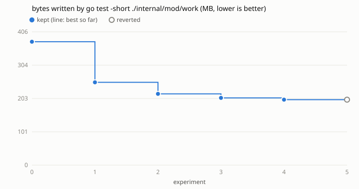

# Loop 1: disk bytes written by `go test -short ./internal/mod/work` in ihsan-sa/hive

Run on 2026-10-29 on iiks1 against ihsan-sa/hive main at 08560925, by the
agent of task 261029-172927-2f0db2ee5e following `../../program.md`.

- **Metric:** `write_bytes` from `/proc/self/io` for the package's test binary
  (`-test.short -test.count=1`) and every git it ran, via `metrics/proc_io.py`.
  The binary is built first (`prepare`, not counted) next to the run's TMPDIR
  on ext4, as `go test` would put it. Lower is better.
- **Noise:** three baseline runs spread 0.004%, every later pair under 0.06%,
  so the 1% floor was the margin. Wall and CPU time are logged but swung
  120-245 s between identical runs on this shared machine, too noisy to judge.
- **Cap:** 12 experiments, one at a time, niced. 5 used: the remaining writes
  are the code under test's own (see below), not the tests'.
- **Editable:** `internal/mod/work/*_test.go` only.

| n | idea | write_bytes | vs best | kept |
|---|------|------------:|--------:|------|
| 0 | baseline | 375.7 MB | | |
| 1 | `TestMain`: empty `GIT_TEMPLATE_DIR`, so ~1,700 inits and clones copy no sample hooks | 252.1 MB | -32.9% | yes |
| 2 | `pushMain` writes its commit with `git fast-import` into the bare repo, not clone+commit+push | 217.0 MB | -13.9% | yes |
| 3 | the same (`commitTo`) for `pushHead`, `keptBeside`, the rig seeds, `moveMain` | 204.7 MB | -5.7% | yes |
| 4 | `pack.writeReverseIndex=false` | 199.2 MB | -2.7% | yes |
| 5 | `transfer.unpackLimit=1000` | 199.3 MB | +0.04% | no |

Total **375.7 → 199.2 MB (-47%)**. Net of pages cancelled before writeback
(`net_write_bytes`): 110.8 → 83.8 MB (-24%). Write syscalls 275k → 213k.
The full (non-short) package suite also passes on the kept branch.

Files: `results.tsv` (every try), `patches/NNN.patch` (every try's diff),
`kept/` (the kept commits as a patch series for ihsan-sa/hive), `config.json`.

## What's left

A trace after try 4 puts what remains in the code under test, not the tests:
each `git config` set writes a whole new config (`config.lock`: `EnsureRepo`
runs 2 after `init --bare`; a checkout 4 after its clone), 724 clones a run,
reflogs (which `checkpoint` reads, so they stay), the journal, and the local
forge's `state.json` rewritten on every change. Going further means editing
internal/core, which a next loop would scope with internal/core's tests in
`check`.

Before this loop, main's commit 377466a1 (hardlinking the test binary into
each test workspace instead of copying it) had already cut the run from about
3.8 GB to 375 MB. That is also what this loop measures when the binary sits on
another filesystem than TMPDIR, so a metric like this one has to build
the binary beside TMPDIR.

## Evidence

Every measurement's full metric output (every `/proc/self/io` field, wall and
CPU seconds) is in the `extra` column of `results.tsv`; each try's repeats are
in `runs`. `logs/` holds the console output kept from the run (the baseline,
try 5, and the full non-short `go test ./internal/mod/work` on the kept
branch). The commands, from this repo's root with ihsan-sa/hive cloned at
`/hive/home/ar/target`:

    python3 loop.py -c runs/hive-work/config.json baseline
    python3 loop.py -c runs/hive-work/config.json try --idea "..."   # once per row
    python3 loop.py -c runs/hive-work/config.json plot

`kept/` applies on ihsan-sa/hive 08560925 with `git am`.
